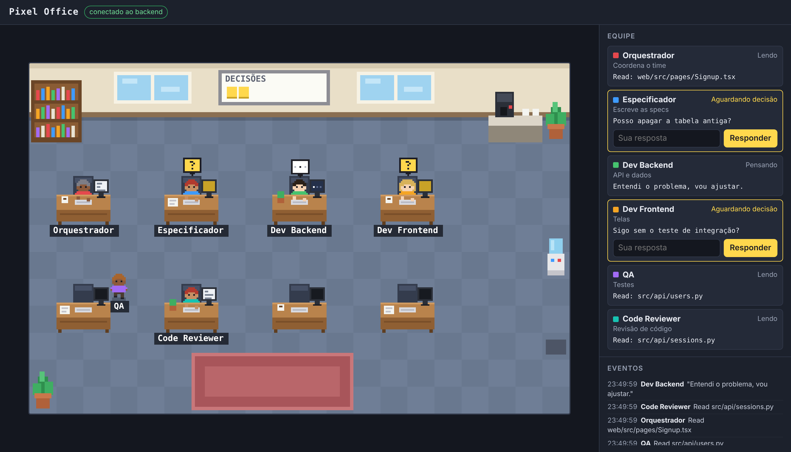

# pixel-office

Harness de desenvolvimento assistido por IA: um time de agentes trabalhando em um
repositório, mostrado como um escritório em pixel.



## Estado atual

O escritório recebe eventos do backend por WebSocket. Nenhum provedor de IA está
ligado ainda: quem gera os eventos é um time simulado.

| Parte | Situação |
| --- | --- |
| Escritório em pixel (`frontend/`) | Funciona, ligado ao backend |
| Backend em Python (`backend/`) | Funciona: estado, WebSocket, entrada de eventos por HTTP |
| Protocolo de eventos | `backend/pixel_office/events.py` e `frontend/src/events.ts` |
| Adaptador Groq | Não começou |
| Adaptador Claude Code | Não começou |

## Como rodar

Requer Python 3.11+ e Node 20+. São dois terminais.

Backend, com o time simulado:

```bash
cd backend
python -m venv .venv
.venv/bin/pip install -e ".[dev]"
.venv/bin/python -m pixel_office --simulate
```

Frontend:

```bash
cd frontend
npm install
npm run dev
```

Abra `http://localhost:5173`. O servidor de desenvolvimento repassa `/ws` e `/api`
para o backend na porta 8000.

Para usar um processo só, rode `npm run build` em `frontend/`: o backend passa a
servir a tela em `http://localhost:8000`.

Sem backend, `http://localhost:5173/?sim` roda um simulador dentro do navegador
(`&seed=5` repete a mesma simulação).

### Opções do backend

| Opção | Padrão | Efeito |
| --- | --- | --- |
| `--simulate` | desligado | Roda o time simulado |
| `--speed N` | 1 | Acelera o simulador |
| `--seed N` | 1 | Semente do simulador |
| `--host`, `PIXEL_OFFICE_HOST` | `127.0.0.1` | Endereço de escuta |
| `--port`, `PIXEL_OFFICE_PORT` | `8000` | Porta |
| `PIXEL_OFFICE_TOKEN` | sem token | Exige o token no WebSocket e nas rotas de API |
| `PIXEL_OFFICE_ORIGINS` | `http://localhost:5173,http://127.0.0.1:5173` | Origens de navegador aceitas no WebSocket |

O servidor se recusa a escutar fora de `127.0.0.1` sem `PIXEL_OFFICE_TOKEN`. Com
token, abra a tela com `?token=SEU_TOKEN`.

### Testes

```bash
cd backend && .venv/bin/pytest && .venv/bin/ruff check .
```

```bash
cd frontend && npm test && npm run typecheck
```

## Como funciona

O escritório não conhece nenhum provedor. Tudo passa por um formato único de
eventos, e cada provedor será um adaptador que publica nesse formato.

```
adaptador (simulador hoje) -> Hub -> WebSocket -> reduce(estado, evento) -> cena + painel
   POST /api/events ---------^
```

### Backend (`backend/pixel_office/`)

| Arquivo | Papel |
| --- | --- |
| `events.py` | Modelos e validação dos eventos |
| `state.py` | Estado do escritório derivado dos eventos |
| `hub.py` | Guarda o estado, distribui eventos e controla decisões pendentes |
| `app.py` | Rotas HTTP e o WebSocket |
| `simulator.py` | Time falso que publica no hub |
| `__main__.py` | Linha de comando |

Um adaptador dentro do processo usa o hub direto:

```python
hub.emit("tool_started", "be", tool="Bash", detail="pytest -q")
answer = await hub.request_decision("be", "Posso apagar a tabela antiga?")
```

Um processo externo publica por HTTP (`ts` é opcional):

```bash
curl -X POST localhost:8000/api/events -H 'content-type: application/json' \
  -d '{"type":"agent_joined","agentId":"be","name":"Dev Backend","role":"API"}'
```

| Rota | Uso |
| --- | --- |
| `GET /api/health` | Situação do servidor |
| `GET /api/state` | Estado atual de todos os agentes |
| `POST /api/events` | Publica um evento; 422 com os erros se for inválido |
| `WS /ws` | Estado ao conectar e eventos em seguida |

Mensagens do WebSocket:

| Sentido | Mensagem |
| --- | --- |
| servidor -> tela | `{"kind":"snapshot","agents":[...],"nextSeq":n}` ao conectar |
| servidor -> tela | `{"kind":"event","event":{...}}` a cada evento |
| servidor -> tela | `{"kind":"error","message":"..."}` quando recusa um comando |
| tela -> servidor | `{"kind":"answer_decision","agentId":"be","answer":"Pode"}` |

A regra que transforma eventos em estado existe em Python e em TypeScript. As duas
rodam os mesmos casos de `shared/reducer-cases.json`; ao mudar uma regra, mude nos
dois lados e nesse arquivo.

### Frontend (`frontend/src/`)

| Arquivo | Papel |
| --- | --- |
| `events.ts` | Tipos dos eventos e a interface `EventFeed` |
| `wsfeed.ts` | Conexão com o backend, com reconexão automática |
| `state.ts` | Máquina de estados dos agentes (`reduce`) |
| `grid.ts` | Planta do escritório e busca de caminho |
| `scene.ts` | Desenho do escritório e movimento dos agentes |
| `sprites.ts`, `look.ts` | Personagens desenhados por código, sem imagens |
| `panel.ts` | Lista do time, resposta de decisões e registro de eventos |
| `simulator.ts` | Simulador local do modo `?sim` |

### Eventos

Todo evento tem `ts` (ms) e `agentId`.

| Evento | Campos | Efeito no agente |
| --- | --- | --- |
| `agent_joined` | `name`, `role` | Entra no escritório, livre |
| `agent_left` | | Sai do escritório |
| `task_started` | `task` | Pensando |
| `thinking` | | Pensando |
| `tool_started` | `tool`, `detail?` | Lendo, editando ou executando, conforme a ferramenta |
| `tool_finished` | `tool`, `ok` | Pensando (falha de ferramenta não é erro do agente) |
| `message` | `text` | Só muda o texto mostrado |
| `waiting_decision` | `question` | Aguardando decisão do usuário |
| `decision_answered` | `answer?` | Pensando |
| `task_finished` | `ok` | Concluiu ou erro |
| `error` | `message` | Erro |

Os nomes de ferramenta seguem os do Claude Code (`Read`, `Grep`, `Glob`, `Edit`,
`Write`, `Bash`). Ferramenta desconhecida aparece como "executando".

### O que o escritório mostra

- Agente com trabalho vai para a própria mesa; livre, circula pela copa e pelo tapete.
- O monitor da mesa muda conforme o status (leitura, edição, terminal).
- Balões: `...` pensando, `?` aguardando decisão, `!` erro, `✓` concluiu.
- O quadro "DECISÕES" na parede ganha uma nota por decisão pendente.
- No painel, o agente que aguarda decisão ganha um campo de resposta. No time
  simulado, a decisão sem resposta se resolve sozinha em 60 segundos.

Há oito mesas. Um nono agente fica sem mesa e trabalha em pé.

## Próximos passos

1. Adaptador Groq: loop de agente com ferramentas, publicando no hub.
2. Adaptador Claude Code: executa o `claude` e traduz a saída para estes eventos.
3. Entrada de tarefas pela tela, para dizer aos agentes o que fazer.
